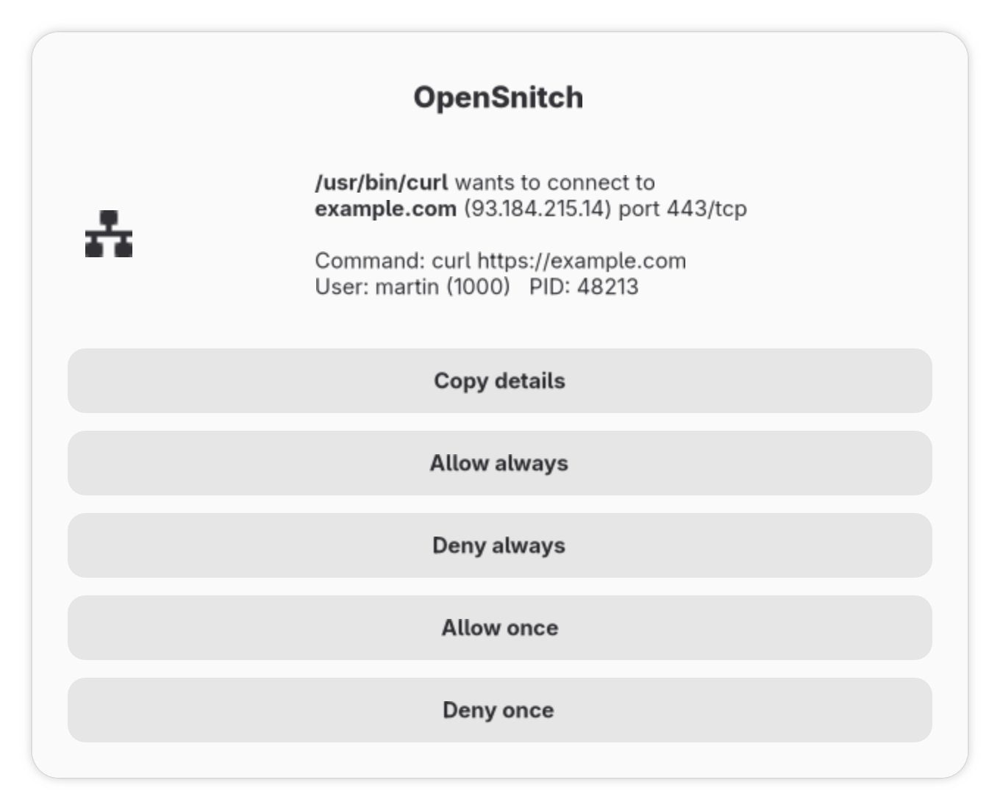
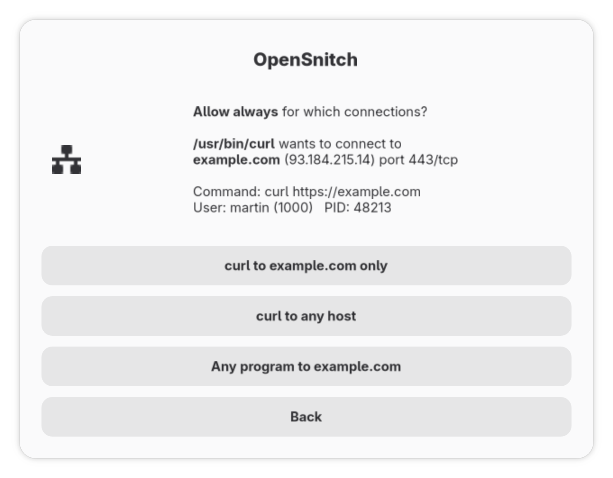

# opensnitch-zenity

[](https://github.com/vmartinv/opensnitch-zenity/actions/workflows/ci.yml)
[](https://github.com/vmartinv/opensnitch-zenity/releases/latest)
[](https://aur.archlinux.org/packages/opensnitch-zenity)
[](LICENSE)

<p align="center">
  
  
</p>

A small prompt UI for the [OpenSnitch](https://github.com/evilsocket/opensnitch)
application firewall daemon. It replaces the Python/Qt `opensnitch-ui` with a
single Go binary that asks about connections using
[zenity](https://gitlab.gnome.org/GNOME/zenity) dialogs.

Unofficial; not affiliated with the OpenSnitch project. Tested against
opensnitchd **1.7.2** on Arch Linux with Hyprland and zenity 4.2.

## What it does and does not do

- Answers the daemon's connection prompts, and nothing else. There is no
  statistics view, rule editor or firewall editor; edit rules as JSON in
  `/etc/opensnitchd/rules/` (the daemon reloads them on change).
- Idle memory is about 20 MB RSS.

### Compared with opensnitch-ui

| | opensnitch-zenity | opensnitch-ui |
|---|---|---|
| Runtime | one static Go binary + zenity | Python 3 + PyQt + plugins |
| Connection prompts | yes | yes |
| Rule scopes from the prompt | program+host, program, host | many (path, command, user, port, IP, network, ...) |
| Rule editor, statistics, firewall editor, tray icon | no; edit JSON in `/etc/opensnitchd/rules/` | yes |
| Multiple nodes (remote daemons) | no | yes |
| Good fit for | tiling WMs / Wayland setups that only want the prompt | desktops that want the full GUI |

## The prompt

For each new connection the daemon asks about:

| Button | Result |
|---|---|
| **Allow once** / **Deny once** | Applies to this connection only. Closing the window = Deny once. |
| **Allow always** / **Deny always** | A second dialog asks what the rule covers (see below). The daemon saves the rule to `/etc/opensnitchd/rules/`. |

Rule scopes offered after "always", most specific first:

| Choice | Rule matches |
|---|---|
| *curl to example.com only* | this program connecting to this host |
| *curl to any host* | this program, any destination |
| *Any program to example.com* | any program connecting to this host |
| *Back* (also Enter, Esc, closing the window) | return to the first dialog |

Both dialogs share `prompt_timeout` (default and maximum 110 s, just under the
daemon's 120 s limit), so a quick first answer leaves the rest for the scope
dialog. If nobody answers the first dialog, `default_action` is applied
**once**; if nobody answers the scope dialog, the chosen action is applied
once. Enter in the scope dialog means *Back*, never the broadest scope.

No dialog is shown, and `default_action` is applied once, when:

- neither `WAYLAND_DISPLAY` nor `DISPLAY` is set,
- your graphical session (logind) is not in the foreground or is locked
  (`LockedHint`), or
- `locked_check_command` exits 0 (for lockers that do not set `LockedHint`).

The daemon asks about one connection at a time and applies **its own**
`DefaultAction` (from `/etc/opensnitchd/default-config.json`) to everything
else while a dialog is open or when no UI is running. An identical connection
repeated within 2 s reuses the previous answer instead of prompting again.

## Install

On Arch Linux, install [from the AUR](https://aur.archlinux.org/packages/opensnitch-zenity):

```sh
yay -S opensnitch-zenity     # or any AUR helper
systemctl --user enable --now opensnitch-zenity.service
sudo systemctl enable --now opensnitchd
```

Or build the same package from a clone:

```sh
sudo pacman -S --needed opensnitch zenity go base-devel
git clone https://github.com/vmartinv/opensnitch-zenity
cd opensnitch-zenity/contrib
makepkg -si
systemctl --user enable --now opensnitch-zenity.service
sudo systemctl enable --now opensnitchd
```

With Nix (flakes):

```sh
nix run github:vmartinv/opensnitch-zenity      # try it
nix profile install github:vmartinv/opensnitch-zenity
```

Elsewhere, download a static binary for x86_64 or arm64 from
[Releases](https://github.com/vmartinv/opensnitch-zenity/releases/latest)
(it needs `zenity` on `PATH`), or run `make build && sudo make install`, which
copies the binary to `/usr/bin` and the unit to `/usr/lib/systemd/user`.

Do not run the stock `opensnitch-ui` at the same time: only one UI can listen
on the socket. opensnitch-zenity refuses to start if another UI is already
listening.

## Configuration

`~/.config/opensnitch-zenity/config.toml` (all keys optional):

```toml
socket = "unix:///tmp/osui.sock"   # must match Server.Address in default-config.json
prompt_timeout = "110s"            # both dialogs together, 1s..110s
default_action = "deny"            # deny | allow | reject, used when nobody answers
notify_on_default = false          # notify-send when default_action is applied
log_level = "info"                 # debug | info | warn | error
zenity_path = "zenity"
locked_check_command = ""          # e.g. "pgrep -x hyprlock"
```

Flags override the file: `--config`, `--socket`, `--timeout`,
`--default-action`, `--log-level`.

Logs go to stderr: `journalctl --user -u opensnitch-zenity -f`.

## Things to know

- **Every user's connections prompt in your session.** opensnitchd is
  system-wide, so other users, root and service accounts (Docker,
  NetworkManager, ...) ask you too; the dialog shows which user. Use rules
  (below) to decide for them in advance.
- **Your own tools prompt too.** Allow your terminal tools, package manager and
  browser early, or the dialogs will keep coming.
- **Socket security.** The socket is created mode 0600 in `/tmp`; the daemon
  runs as root and can still connect. Any local user could create
  `/tmp/osui.sock` first if no UI is running; use a path under
  `/run/user/$UID` in both configs if that matters on your machine.
- **Window rules.** zenity dialogs are normal windows. On Hyprland they float
  and center by default; otherwise match the window title `OpenSnitch`.

## Writing rules by hand

The dialog only creates the common rule shapes. Anything else is a JSON file
in `/etc/opensnitchd/rules/`; the daemon picks up changes immediately. A rule
with several conditions uses a `list` operator, and all conditions must match:

```json
{
  "name": "allow-curl-started-by-myapp",
  "enabled": true,
  "precedence": false,
  "action": "allow",
  "duration": "always",
  "operator": {
    "type": "list", "operand": "list", "data": "", "sensitive": false,
    "list": [
      {"type": "simple", "operand": "process.path", "data": "/usr/bin/curl", "sensitive": false},
      {"type": "simple", "operand": "process.parent.path", "data": "/usr/bin/myapp", "sensitive": false}
    ]
  }
}
```

Useful operands: `process.path`, `process.parent.path` (matches any
ancestor), `process.command`, `user.id`, `dest.host`, `dest.ip`,
`dest.network`, `dest.port`, `protocol`. Types: `simple`, `regexp`,
`network`, `list`.

When several rules match, the daemon checks them in name order and a
`deny`/`reject` rule wins over `allow` rules, unless an `allow` rule that
comes first has `"precedence": true`. For example, a `deny` rule on
`user.id` blocks everything that user does, except programs whose `allow`
rules have precedence.

## Development

```sh
make test     # unit tests + integration tests over a real unix socket
make vet      # gofmt + go vet
make proto    # regenerate proto/*.pb.go after updating proto/ui.proto
```

`proto/ui.proto` is vendored unchanged (apart from `go_package`) from
OpenSnitch v1.7.2. Rule replies mirror what the stock UI sends
(`opensnitch/dialogs/prompt`). For a new daemon version, replace the proto,
run `make proto`, and check the daemon's `daemon/ui/client.go` and
`daemon/rule/rule.go` for changes.

Manual end-to-end check (keep the daemon's `DefaultAction` at `allow` while
experimenting so nothing gets cut off):

```sh
sudo systemctl start opensnitchd
./opensnitch-zenity --log-level debug --default-action allow
curl https://example.org                 # dialog appears; choose Allow always
sudo ls /etc/opensnitchd/rules/          # allow-always-...json saved by the daemon
sudo tail /var/log/opensnitchd.log       # "Saved new rule: ..."
```

## License

GPL-3.0-or-later. See [LICENSE](LICENSE).
